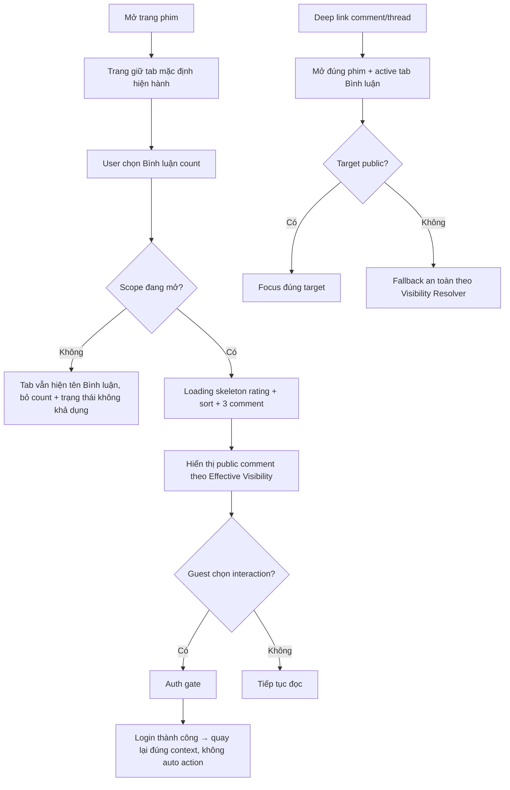

# User Flow — US01 Đọc khu vực bình luận

> User Story: [US01_DOC_KHU_VUC_BINH_LUAN.md](US01_DOC_KHU_VUC_BINH_LUAN.md)

**Platforms:** Phone, Web, Smart TV  
**Actor:** Guest / User đăng nhập

## Flow

## UX đã chốt

- Comment là **tab riêng**. Phim bộ mặc định tab `Danh sách tập`; phim lẻ mặc định tab `Đề xuất`. User chủ động chọn tab Bình luận.
- Tab mở hiển thị `Bình luận ({public_count})`; scope Đóng chỉ hiển thị `Bình luận`.
- Comment dài tối đa **3 dòng** → `Xem thêm` / `Thu gọn`.
- Rời tab rồi quay lại trong cùng phiên: giữ scroll, sort, thread mở, trạng thái expand/collapse; refresh dữ liệu ngầm không reset context.
- Có dữ liệu mới khi đang đọc: không tự chèn; hiện `Có {n} bình luận mới` để user chủ động refresh.
- Guest được đọc public content; login chỉ khi tương tác.
- Empty: logged-in có CTA viết đầu tiên; Guest có CTA login; SmartTV có hướng dẫn + QR chuyển sang smartphone.
- **Smart TV chỉ áp dụng US01, US07, US10 và US17.** TV đọc danh sách gốc, mở trang thread chỉ đọc để xem reply, Thích/Bỏ thích, Báo cáo bình luận và hiển thị huy hiệu. Không composer, không Trả lời/Sửa/Xóa/Nhắc tên/Chia sẻ, không đổi sort, không chấm sao, không seek timestamp.
- Danh sách trên Smart TV kế thừa quy tắc render của US02 (count trên tab, tối đa 3 pin trên cùng, thứ tự `Nổi bật`, lazy load 10 root/batch) nhưng không có control sort.
- Smart TV không áp dụng cơ chế Làm mờ: nội dung comment hiển thị nguyên văn, không có dải mờ.

## States

Loading skeleton · Empty · Populated · Auth gate · Scope Closed · Target unavailable · Background refresh.
