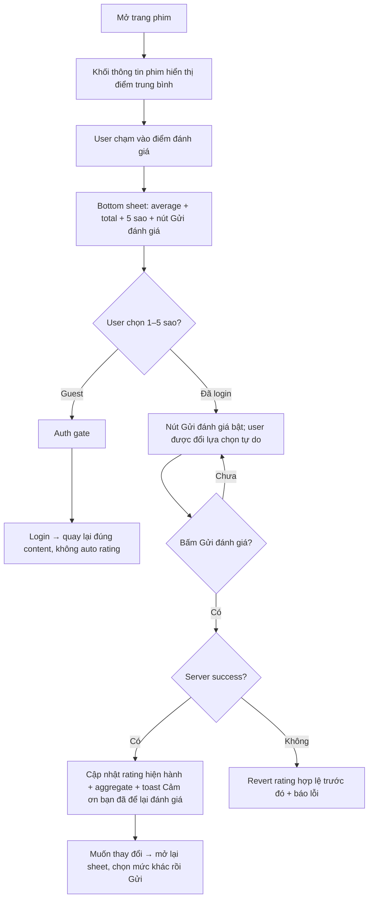

# User Flow — US03 Đánh giá 5 sao

> User Story: [US03_DANH_GIA_PHIM.md](US03_DANH_GIA_PHIM.md)

**Platforms:** Phone, Web, SmartTV

## Flow

## UX/Business đã chốt

- Rating nằm ở **khối thông tin phim**, không nằm trong tab Bình luận; entry point là điểm trung bình trên khối đó.
- Rating ở **cấp phim** cho cả phim lẻ và phim bộ: một account có tối đa một rating hiện hành trên mỗi bộ phim.
- Một account có 1 rating hiện hành/content scope.
- User **được thay đổi 1–5 sao nhưng không được xóa rating**.
- Chọn sao **chưa** gửi; phải bấm nút `Gửi đánh giá` để xác nhận. Nút disabled khi chưa chọn sao. Đóng sheet giữa chừng thì rating cũ giữ nguyên.
- Mở lại sheet khi đã từng đánh giá thì hiển thị sẵn mức sao hiện hành.
- Submit lỗi: revert rating cũ, không tự retry.
- **Scope Đóng bình luận không ảnh hưởng rating**: vẫn hiển thị aggregate và vẫn nhận đánh giá mới.
- SmartTV cho đánh giá bằng remote nếu đã đăng nhập.
- A11y: radiogroup, mỗi option label `{n} sao`.
