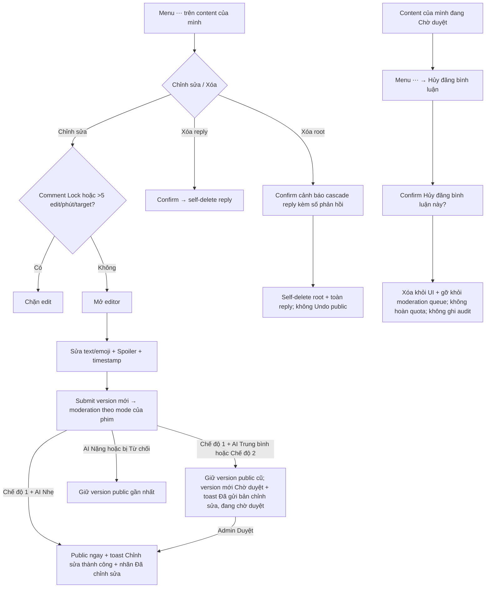

# User Flow — US05 Sửa và xóa bình luận

> User Story: [US05_SUA_VA_XOA_BINH_LUAN.md](US05_SUA_VA_XOA_BINH_LUAN.md)

**Platforms:** Phone, Web

## UX đã chốt

- Action của chính user nằm trong menu `⋯` (kebab mở bottom sheet).
- Edit được sửa toàn bộ text/emoji, đoạn Làm mờ (Spoiler), timestamp.
- **Kết quả của một lần sửa phụ thuộc chế độ kiểm duyệt của phim**, không phải luôn public ngay; hai toast phân biệt rõ: `Chỉnh sửa thành công` và `Đã gửi bản chỉnh sửa, đang chờ duyệt`.
- Pending content vẫn được edit; version pending cũ được thay bằng version mới, không tạo nhiều pending song song.
- Edit limit 5/phút/target.
- **Hủy đăng nội dung đang Chờ duyệt** là lifecycle riêng: không hoàn lại quota 5 nội dung/phút, không ghi audit log, gỡ khỏi moderation queue ngay, không có đường khôi phục.
- Self-delete root khác CMS delete; user không có Undo public.
