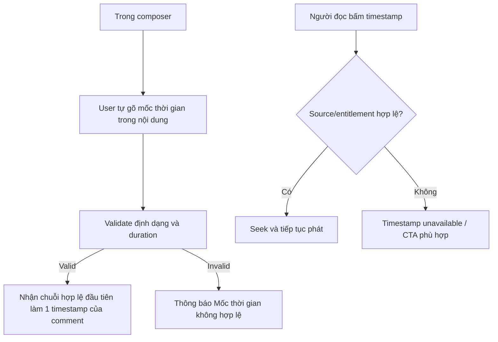

# User Flow — US06 Bình luận kèm mốc thời gian

> User Story: [US06_BINH_LUAN_KEM_MOC_THOI_GIAN.md](US06_BINH_LUAN_KEM_MOC_THOI_GIAN.md)

**Platforms:** Phone, Web. Smart TV không áp dụng US06.

## UX đã chốt

- **Không có chức năng “Gắn thời gian hiện tại”**: hệ thống không lấy mốc đang phát từ player. Timestamp hoàn toàn do user gõ tay trong nội dung.
- Dưới 1 giờ: `mm:ss` (vd `12:32`); từ 1 giờ: `hh:mm:ss` (vd `01:12:32`).
- Nội dung có nhiều chuỗi thời gian hợp lệ thì chỉ chuỗi **đầu tiên** thành timestamp, phần còn lại là text thường.
- Chức năng chỉ áp dụng cho **phim lẻ**. Timestamp phải thuộc phim hiện tại và không vượt duration; sai thì báo `Mốc thời gian không hợp lệ`.
- Edit comment được sửa timestamp.
- Smart TV không seek theo mốc thời gian: chuỗi thời gian trong nội dung hiển thị như chữ thường, không bấm được.
- Share deep link không auto-seek.
