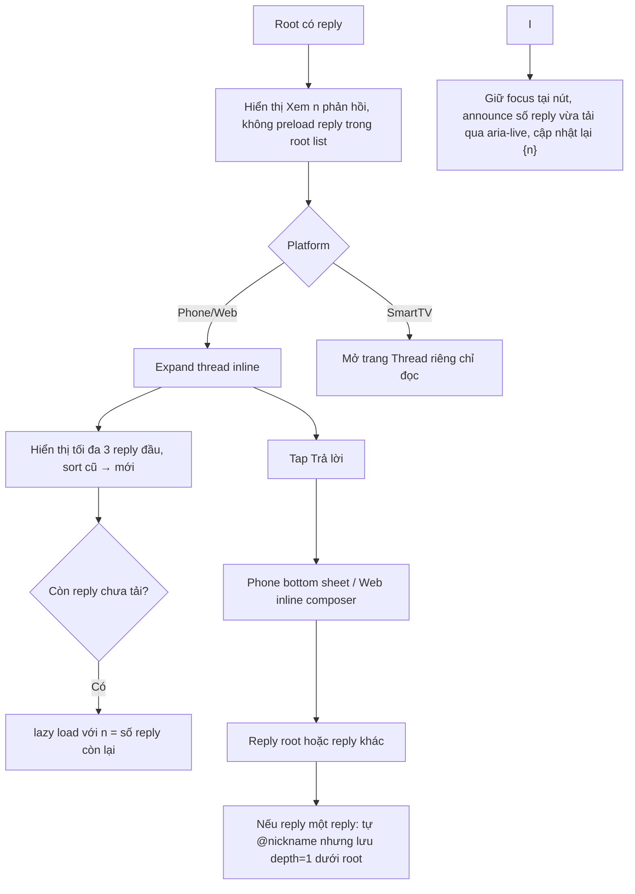

# User Flow — US08 Trả lời bình luận một cấp

> User Story: [US08_TRA_LOI_BINH_LUAN_MOT_CAP.md](US08_TRA_LOI_BINH_LUAN_MOT_CAP.md)

**Platforms:** Phone, Web; SmartTV chỉ đọc thread.

## UX đã chốt

- Root list không hiển thị sẵn reply; chỉ action `Xem {n} phản hồi`.
- Khi mở thread, **initial hiển thị tối đa 3 reply**, sort **cũ → mới** (AC9).
- Phần reply còn lại tải dùng infinite scroll/lazy load theo cuộn. Mỗi lần bấm tải **tối đa 10 reply**; nếu phần còn lại <10 thì tải hết (AC10, TC-US08-008). Số `{n}` trên nút được cập nhật lại sau mỗi lần tải;
- Lưu ý phạm vi: **infinite scroll vẫn đúng cho danh sách root comment (US02)**; 
- Có reply mới khi thread mở: indicator `Có {n} phản hồi mới`; user bấm → tải và cuộn tới reply mới đầu tiên.
- SmartTV mở trang thread riêng, chỉ đọc; không Reply.
