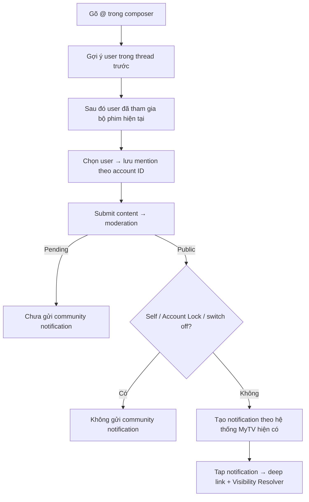

# User Flow — US09 Mention và thông báo

> User Story: [US09_MENTION_VA_NHAN_THONG_BAO.md](US09_MENTION_VA_NHAN_THONG_BAO.md)

**Platforms:** Phone, Web. Smart TV không tạo Mention và không có màn cấu hình; riêng quy tắc hiển thị + điều hướng notification (AC10–AC13) áp dụng cho mục thông báo của app TV.

## UX đã chốt

- Không tìm kiếm toàn bộ user MyTV; ưu tiên thread rồi content scope hiện tại.
- Notification Center **giữ nguyên 1 feed hiện có của MyTV**; flow này không thiết kế IA/tab/filter mới.
- Notification moderation/sanction/appeal/report-result vẫn bắt buộc theo business rule.
- Smart TV không tạo Mention: `@nickname` trên TV chỉ là chữ trong nội dung comment (thuộc phần đọc của US01), không phải mention tương tác. TV cũng không có màn cấu hình Thông báo cộng đồng — switch nằm ở Phone/Web và áp dụng cấp account.
- Mục thông báo sẵn có của app Smart TV hiển thị **đầy đủ** notification của account (Reply/Mention, moderation/chế tài, kết quả Báo cáo, huy hiệu); bấm vào notification có target bình luận thì mở đúng phim/tab Bình luận hoặc thread chỉ đọc `C17`, fallback theo US12 khi target không còn hợp lệ.
