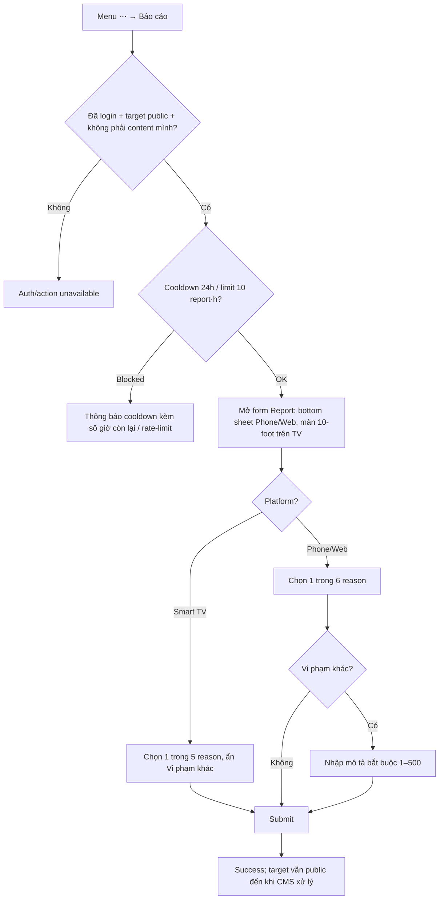

# User Flow — US10 Report bình luận

> User Story: [US10_REPORT_BINH_LUAN_VI_PHAM.md](US10_REPORT_BINH_LUAN_VI_PHAM.md)

**Platforms:** Phone, Web, Smart TV (taxonomy rút gọn 5 reason).

## UX đã chốt

- Report mở bằng bottom sheet trên Phone/Web.
- Sau report thành công, action `Báo cáo` vẫn hiện; tap lại trong 24h báo đúng microcopy đã chốt tại US10: **“Bạn đã báo cáo bình luận này — Có thể báo cáo lại sau {n} giờ nếu nội dung vẫn còn.”** `{n}` là số giờ còn lại của cooldown 24h, phải hiển thị động để user biết cần chờ bao lâu.
- Smart TV áp dụng US10: entry là menu action rút gọn chỉ gồm `Báo cáo`; form hiện 5 reason và ẩn `Vi phạm khác` vì reason đó bắt buộc nhập mô tả. Cooldown 24h và rate limit 10/giờ tính theo account, dùng chung quota với Phone/Web.
- Thông báo kết quả xử lý Report cho user trên Smart TV vào mục thông báo sẵn có của ứng dụng TV; bấm vào thông báo mở đúng phim/comment liên quan, fallback theo US12 nếu target không còn hợp lệ.
