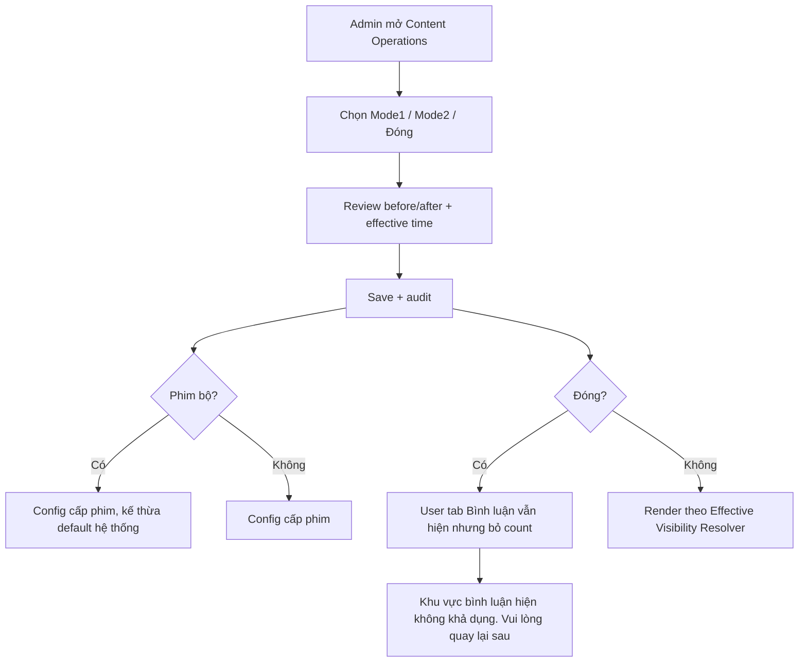

# User Flow — US12 Trạng thái và phạm vi hiển thị

> User Story: [US12_QUAN_LY_TRANG_THAI_VA_PHAM_VI_HIEN_THI_BINH_LUAN.md](US12_QUAN_LY_TRANG_THAI_VA_PHAM_VI_HIEN_THI_BINH_LUAN.md)

**Platform:** CMS Web/Desktop only (Admin cấu hình). Effective Visibility Resolver do backend áp dụng cho mọi nền tảng; ứng dụng Phone/Web/Smart TV chỉ render kết quả theo các state đã đặc tả ở US01, không phát sinh chức năng mới trên app.

## UX/Scope đã chốt

- Phạm vi đọc/comment/rating phía người xem là **bộ phim**, áp dụng chung cho phim lẻ và phim bộ.
- CMS cấu hình Mode1/Mode2/Đóng ở **cấp phim**, kế thừa default hệ thống khi không có override.
- Scope Đóng: tab `Bình luận` vẫn tồn tại, không count, không list/composer/interaction; rating vẫn hoạt động.
- Deep link vào scope Đóng mở đúng phim + tab Bình luận + fallback.
- Resolver priority: self-delete → own moderation → Admin root cascade → Account Lock → scope Closed.
