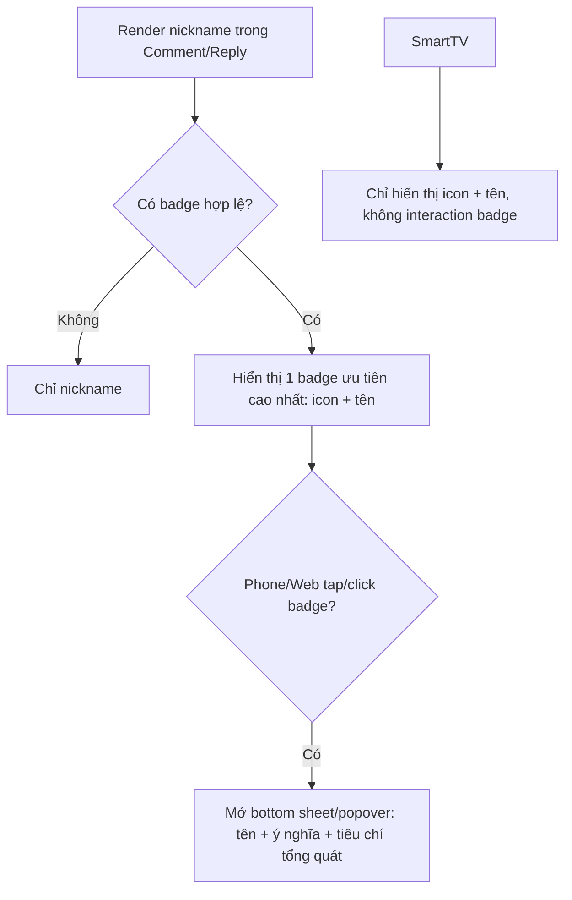

# User Flow — US17 Huy hiệu người dùng

> User Story: [US17_HUY_HIEU_NGUOI_DUNG.md](US17_HUY_HIEU_NGUOI_DUNG.md)

**Platforms:** Phone, Web, Smart TV (TV chỉ hiển thị icon + tên, không mở detail badge).

## UX đã chốt

- Ví dụ hiển thị: `Minh Anh · Fan kỳ cựu`.
- Không chỉ dùng icon/màu; phải có text alternative.
- Phone/Web mở giải thích badge tại chỗ, không rời thread.
- Smart TV chỉ hiển thị huy hiệu (icon + tên), không mở detail badge. Thông báo cấp huy hiệu vào mục thông báo sẵn có của ứng dụng Smart TV và hiển thị dạng đọc, không có CTA `Xem huy hiệu` vì TV không có màn chi tiết huy hiệu.
- Chỉ hiển thị 1 badge theo priority rule hiện hành.
